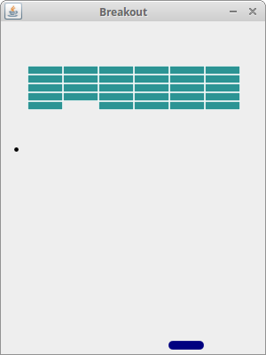

# Breakout Game – CCSW 413 Design Patterns Project

This is our group project for **CCSW 413 Software Design Patterns** at the University of Jeddah.
We took an open-source Java Breakout game and we're refactoring it using design patterns, two from each category (Creational, Structural, Behavioral), one stage at a time.

Original game by Jan Bodnar: https://github.com/janbodnar/Java-Breakout-Game (BSD 2-Clause License)



## Team
- Banan Fadhel
- Enas Alqarni
- Dana Alshahrani
- Jana Akkad
- Joury Ghorab

## Progress
- [x] Stage 1 – Creational: Factory Method + Builder
- [x] Stage 2 – Structural: Composite + Flyweight
- [ ] Stage 3 – Behavioral

## Stage 2 – What we did

### Composite (the brick wall)
Before, `Board` kept a `Brick[]` and had separate loops to draw the bricks, check the ball against each brick and test for victory.
Now the wall is a tree: `BrickGroup` (wall) → `BrickGroup` (rows) → `Brick` (leaves). `Brick` and `BrickGroup` both implement `BrickComponent`, so `Board` just calls
`wall.draw(...)`, `wall.checkCollision(ball)` and `wall.isDestroyed()`. The level builders now build rows of bricks and put them in the wall.

### Flyweight (shared pictures)
Before, every `Sprite` loaded its own picture from disk (`new ImageIcon(path)`), so the 30 bricks loaded the same PNG 30 times.
Now `SpriteImageFactory` loads each picture once and shares it as a `SpriteImage` (intrinsic state: image and size).
Each sprite keeps only its own position (extrinsic state) and passes it to `SpriteImage.draw(g, x, y, observer)`.

## Stage 1 – What we did

### Factory Method (creating bricks)
Before, `Board` created every brick directly with `new Brick(x, y)`.
Now bricks are created through `BrickFactory`, and `ClassicBrickFactory` decides which brick to make:
- `'N'` → normal `Brick` (breaks in 1 hit)
- `'S'` → `StrongBrick` (needs 2 hits, cracks after the first one)

### Builder (building levels)
Before, the whole level was hard-coded inside `Board.gameInit()`.
Now we followed the Robot example from the lecture:
- `Level` is the product (bricks + speed)
- `LevelBuilder` is the builder interface
- `ClassicLevelBuilder` and `HardLevelBuilder` build two different levels
- `LevelEngineer` is the director that calls the building steps
- `Board` just asks for the finished level

The two patterns work together: each builder gets a `BrickFactory` and uses it to create the bricks.

When the game starts, a menu lets the player pick the level: press **1** for Classic or **2** for Hard. Board then passes the chosen builder to `LevelEngineer`. After Game Over or Victory, press **Enter** to go back to the menu.

## How to run
Run these from the project folder:
```bash
javac -d out src/com/zetcode/*.java
java -cp out com.zetcode.Breakout
```
Pick a level with **1** or **2**, then use the left and right arrow keys to move the paddle.
