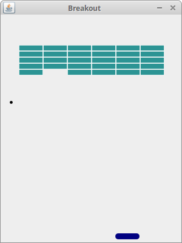

# Java Breakout Game – CCSW 413 Software Design Patterns Project

Course project for **CCSW 413 Software Design Patterns** (University of Jeddah, First Semester 2025/2026).
We refactor an existing open-source Java Swing game by applying design patterns in three stages.

Original code: [janbodnar/Java-Breakout-Game](https://github.com/janbodnar/Java-Breakout-Game) by Jan Bodnar
(http://zetcode.com/javagames/breakout/), available under the 2-Clause BSD License.



## Project stages

| Stage | Category | Patterns | Status |
| --- | --- | --- | --- |
| 1 | Creational | Factory Method, Builder | Done |
| 2 | Structural | – | Coming soon |
| 3 | Behavioral | – | Coming soon |

## Stage 1 – Creational patterns

### Factory Method (brick creation)
`Board` no longer calls `new Brick(x, y)`. Bricks are created through the abstract creator
`BrickFactory.createBrick(type, x, y)`, and the concrete creator `ClassicBrickFactory` decides
which class to instantiate: `'N'` → `Brick` (one hit), `'S'` → `StrongBrick` (two hits, cracked image after the first).

| Role | Class |
| --- | --- |
| Product | `Brick` |
| Concrete Product | `Brick`, `StrongBrick` |
| Creator | `BrickFactory` (abstract) |
| Concrete Creator | `ClassicBrickFactory` |

### Builder (level construction)
The level is no longer hard-coded inside `Board.gameInit()`. It follows the Robot example from the lecture:
the director `LevelEngineer` calls the building steps (`buildBricks()`, `buildSpeed()`) on a `LevelBuilder`,
and `Board` takes the finished `Level`.

| Role | Class |
| --- | --- |
| Product | `Level` |
| Builder | `LevelBuilder` (interface) |
| Concrete Builder | `ClassicLevelBuilder`, `HardLevelBuilder` |
| Director | `LevelEngineer` |
| Client | `Board` |

The two patterns work together: each level builder receives a `BrickFactory` and creates every brick through it.

```java
LevelBuilder builder = new ClassicLevelBuilder(new ClassicBrickFactory());
LevelEngineer engineer = new LevelEngineer(builder);
engineer.makeLevel();
Level level = engineer.getLevel();
```

To play the hard level, change the builder in `Board.gameInit()` to `new HardLevelBuilder(new ClassicBrickFactory())`.

## How to run

Run from the project root (images are loaded from `src/resources/`):

```bash
javac -d out src/com/zetcode/*.java
java -cp out com.zetcode.Breakout
```
